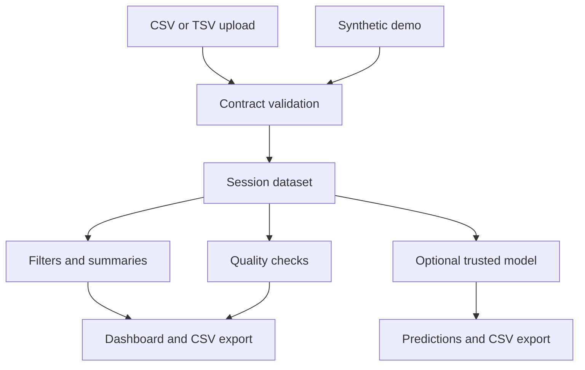

# Architecture

`R/data.R` is independent of UI state. `R/model.R` is the adapter for versioned local artifacts. `app.R` manages per-session datasets and invalidates scored results when the selection changes. No `.RData` image, absolute home path, live scraper or embedded API key is required.

Uploaded content is displayed through escaped DT tables; complaint narrative is not included in model predictions. Input size is limited. Shiny uses normal server temporary-upload processing. Hosting, retention, authentication, concurrency and transport encryption remain deployment responsibilities; this local portfolio edition is not a multi-tenant production platform.

Historical CSVs and geographic references remain local. Municipality names alone are ambiguous, so no state enrichment join is performed without a reliable municipality/state or code key. Raw data are excluded from Git. Demo data are synthetic; the architecture supports original uploads through the same contract.

Model artifacts are installed by the operator, never read from user uploads. A model schema version and feature signature must match before scoring. Exported row numbers map to the current filtered selection; changing it clears stale predictions.
